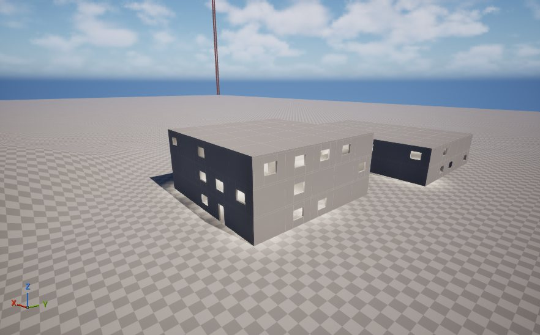
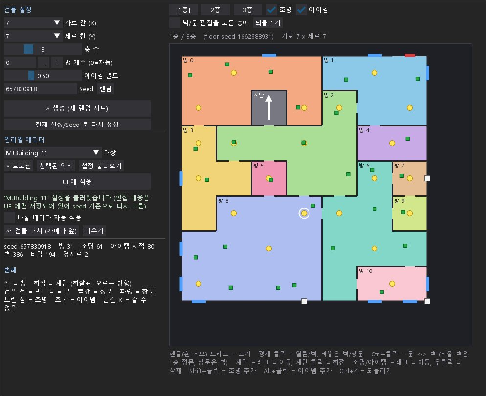

# MJBuilding

Unreal Engine 5.8 에디터에서 모듈식 건물과 층별 평면도를 생성·편집하는 도구입니다. MarkovJunior 규칙으로 방을 만들고 Python 후처리로 계단, 동선, 조명과 아이템 스폰 지점을 계산합니다.




## 포함 범위

- `Content/Python/mj_core.py`: 평면도 생성, 계단·방 연결 보정, 메시 배치용 Transform 계산.
- `Content/Python/mj_gui.py`: 층별 평면도 편집과 Unreal MCP 연동 GUI.
- `Content/Python/mj_ue.py`: 블루프린트의 생성·재생성·미리보기·비우기 버튼 연결.
- `Content/Python/mj/`: 기존 도구에서 사용하던 Windows용 MarkovJunior 실행 파일과 리소스.
- `Content/_Jinoh/BluePrint/BP_MJBuilding.uasset`: 건물 생성 블루프린트.
- `MJBuilding.uproject`: 필요한 에디터 플러그인이 활성화된 도구 전용 프로젝트.
- `docs/images/`: 기존 도구 설명 자료에서 추출한 실제 건물 외관·실내·GUI 사진 3장.

게임 맵, 캐릭터, 인벤토리, 무기와 애니메이션은 포함하지 않습니다. 원본 Monday 프로젝트에서 도구를 복사해 분리했으며 기존 Python 함수명과 블루프린트 노드 배치는 유지했습니다.

## 실행 환경

- Windows x64
- Python 3과 `dearpygui==2.3.1`
- .NET Runtime 10 x64: 동봉한 MarkovJunior가 `net10.0`을 대상으로 합니다.
- Unreal 연동: Unreal Engine 5.8, Python Editor Script Plugin, Editor Scripting Utilities.
- GUI의 Unreal 적용 기능: `ModelContextProtocol`과 `EditorToolset` 플러그인 및 `http://127.0.0.1:8000/mcp` 서버.

MCP 없이도 오프라인 GUI와 평면도 생성은 사용할 수 있습니다. Unreal 플러그인과 엔진 파일은 이 저장소에 포함하지 않습니다.

## 오프라인 실행

저장소 폴더에서 다음 명령을 실행합니다.

```powershell
python -m pip install -r requirements.txt
python Content/Python/mj_gui.py --offline
```

평면도만 콘솔에서 확인하려면 다음처럼 실행합니다. 인자는 가로 칸, 세로 칸, 층 수, 시드입니다. 가로·세로는 3 이상의 홀수입니다.

```powershell
python Content/Python/mj_core.py 5 5 3 481
```

## Unreal에서 바로 열기

1. 실행 환경을 설치한 뒤 `MJBuilding.uproject`를 Unreal Engine 5.8로 엽니다.
2. 새 레벨을 만들고 콘텐츠 브라우저에서 `BP_MJBuilding`을 레벨에 배치합니다.
3. `RoomsX`, `RoomsY`, `NumFloors`, `Seed`를 설정하고 `BtnGenerate`를 누릅니다. `Seed=0`은 매번 새 시드를 선택합니다.
4. 같은 결과는 `BtnRebuildLastSeed`, 평면도 로그는 `BtnPreviewPlan`, 데이터 제거는 `BtnClear`, 편집기는 `BtnOpenGUI`를 사용합니다.

에셋의 `ScriptPath`는 `mj_ue.py`입니다. Unreal이 `Content/Python`에서 스크립트를 검색하므로 PC별 절대 경로 수정이 필요 없습니다. 아이템 클래스 기본값은 비워 두어 게임 인벤토리에 의존하지 않습니다.

## 기존 프로젝트에 붙여넣기

1. 대상 에디터를 닫고 이 저장소의 **`Content` 폴더 전체**를 대상 프로젝트의 `Content`에 합칩니다. 같은 이름의 파일이 이미 있다면 먼저 백업합니다.
2. 위에 적힌 Python·에디터 플러그인을 활성화하고 에디터를 다시 엽니다. Blueprint 버튼으로 생성할 때는 Python 플러그인이 필요하고, GUI에서 Unreal에 적용할 때는 MCP와 EditorToolset도 필요합니다.
3. GUI 적용을 사용하려면 MCP 서버를 8000 포트로 시작합니다. 이 저장소의 도구 전용 프로젝트에는 자동 시작 설정이 들어 있습니다.
4. `BP_MJBuilding`을 레벨에 배치하고 사용합니다. `ScriptPath`는 그대로 둡니다.

GUI를 직접 실행해 MCP로 적용할 수도 있습니다.

```powershell
python Content/Python/mj_gui.py
```

또는 `RunGUI.cmd`를 실행합니다. GUI에서 대상 건물을 선택한 뒤 **설정 불러오기 → 편집 → UE에 적용** 순서로 사용합니다. 원래 패키지 경로를 바꾸면 `Content/Python/mj_gui.py`의 `BP_CLASS`도 맞춰야 합니다.

## 편집 조작

- 흰 핸들 드래그: 가로·세로 칸 수 변경.
- 경계 클릭: 벽·열림 또는 외벽·창문 전환.
- Ctrl+클릭: 문 전환. 외벽 정문은 1층에서만 설정합니다.
- 계단 드래그 / 클릭: 계단 위치 이동 / 방향 회전.
- 조명·아이템 드래그 / 우클릭: 이동 / 삭제.
- Shift+클릭 / Alt+클릭: 조명 / 아이템 지점 추가.
- Ctrl+Z: 편집 취소.

아이템 지점과 실제 게임 아이템 클래스는 별개입니다. 게임에서 아이템을 생성하려면 대상 프로젝트의 클래스들을 건물 액터의 `ItemClasses`에 지정합니다.

생성 결과는 액터의 Transform 배열에 저장됩니다. 생성된 건물을 게임에서 표시하는 데에는 외부 Python과 MarkovJunior가 필요하지 않습니다. 레벨에 배치한 결과를 다른 프로젝트로 전달할 때는 그 레벨과 외부 액터 데이터도 별도로 옮겨야 합니다. 이 저장소에는 생성 도구만 들어 있습니다.

## 확인한 내용

분리한 복사본에서 Python 문법, 고정 시드 재현성, 5×5·3층 생성 결과의 층별 도달 가능 여부와 기존 GUI 편집 자체 점검을 실행했습니다. 별도 Unreal 프로젝트를 새로 실행해 블루프린트의 게임 콘텐츠 의존성이 0개인지 확인하고, 벽 258개·바닥 98개·계단 2개·등기구 31개가 실제 인스턴스로 생성되는 것까지 확인했습니다. 언리얼 명령 실행 결과는 오류 0개·경고 0개입니다. 기존 2개 그래프·73개 노드의 구성·연결·위치는 그대로입니다. 기존 스크린샷은 이전 Monday 에디터에서 촬영한 결과입니다.

## 외부 구성 요소

MarkovJunior 실행 파일은 기존 도구에서 사용한 텍스트 격자 출력 패치 버전입니다. 수정된 C# 소스는 이 추출본에 포함되지 않습니다. 외부 구성 요소와 라이선스 파일은 [THIRD_PARTY_NOTICES.md](THIRD_PARTY_NOTICES.md)에 정리했습니다.
